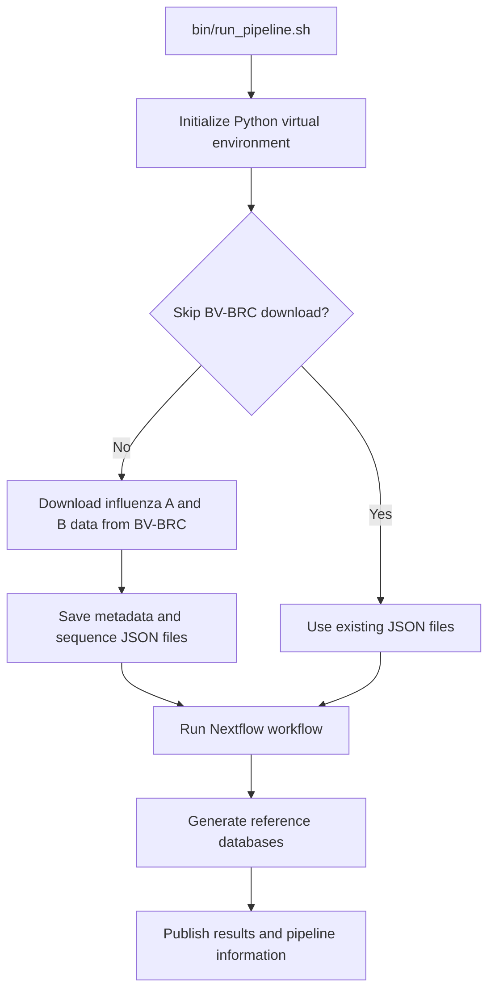
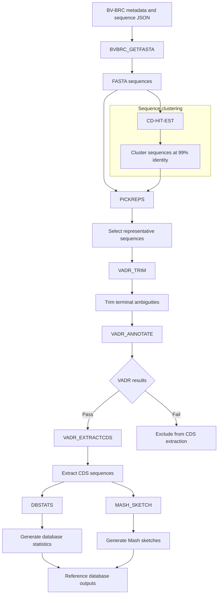

# fluab-reference-db

Automated reference database generation for the ProvLab influenza A and B bioinformatics pipeline, [nf-fluab](https://github.com/xiaoli-dong/nf-fluab).

`fluab-reference-db` retrieves influenza reference metadata and nucleotide sequences from [BV-BRC](https://www.bv-brc.org), processes the downloaded data through a Nextflow workflow, and generates reference databases for downstream influenza sequence analysis.

The workflow is launched using a single entry-point script, `bin/run_pipeline.sh`, which automates Python environment setup, BV-BRC data downloading, and Nextflow execution.

## Features

- Automatically downloads influenza A and B reference data from BV-BRC
- Retrieves sequence metadata and nucleotide sequences in batches
- Supports configurable batch sizes and download limits
- Processes downloaded data using Nextflow
- Clusters similar sequences at 99% identity and selects representative sequences
- Validates and processes influenza reference sequences using VADR
- Extracts coding sequences (CDS)
- Generates database statistics and Mash sketches
- Generates versioned reference databases for `nf-fluab`
- Supports resuming interrupted Nextflow runs
- Produces Nextflow execution reports and workflow information

## Workflow overview

The pipeline is launched through `bin/run_pipeline.sh`, which handles environment setup, reference data downloading, and Nextflow execution.



### Reference database generation

The Nextflow workflow processes the downloaded BV-BRC reference data through the following steps:



## Requirements

The following software and environment are required:

- Linux
- Python 3
- Conda
- Nextflow
- Singularity or Apptainer
- A Conda environment named `nf-core-4`, with Nextflow and the required nf-core tools available

The launcher automatically creates a Python virtual environment (`.venv`) and installs dependencies from `requirements.txt` when needed.

The launcher uses the `singularity` Nextflow profile by default.

## Installation

Clone the repository:

```bash
git clone https://github.com/xiaoli-dong/fluab-reference-db.git
cd fluab-reference-db
```

Ensure that the `nf-core-4` Conda environment and Singularity/Apptainer are available before running the pipeline.

## Usage

### Run the pipeline

The recommended entry point is:

```bash
bash bin/run_pipeline.sh
```

To specify an output directory:

```bash
bash bin/run_pipeline.sh --outdir results
```

By default, the launcher:

1. Creates or reuses a Python virtual environment (`.venv`).
2. Installs the required Python dependencies.
3. Downloads influenza A and B metadata and sequences from BV-BRC.
4. Saves the downloaded JSON files under `data/` in the output directory.
5. Activates the `nf-core-4` Conda environment.
6. Runs the Nextflow workflow using the Singularity profile.
7. Uses the current date (`YYYYMMDD`) as the database version.
8. Runs Nextflow with `-resume`.

### Launcher parameters

| Parameter | Default | Description |
|---|---:|---|
| `--outdir` | Current directory, or `OUTDIR_ENV` if set | Output directory for downloaded data and workflow results |
| `--batch` | `200` | Metadata page size and sequence batch size |
| `--seq-limit` | `200` | Maximum number of sequences returned per BV-BRC request |
| `--max` | Unlimited | Maximum number of records retrieved per taxon |

All numeric parameters must be positive integers.

For example, to limit downloads to 500 records per taxon:

```bash
bash bin/run_pipeline.sh --outdir test_results --max 500
```

To change the download batch size:

```bash
bash bin/run_pipeline.sh \
    --outdir results \
    --batch 100 \
    --seq-limit 100
```

### Override the database version

By default, the launcher generates the database version using the current date (`YYYYMMDD`).

To specify a custom version:

```bash
DB_VERSION=20261125 bash bin/run_pipeline.sh --outdir results
```

### Skip downloading reference data

If the BV-BRC data have already been downloaded and are available in the selected output directory, the download step can be skipped:

```bash
SKIP_DOWNLOAD=1 bash bin/run_pipeline.sh --outdir results
```

The following files must already exist:

```text
results/
└── data/
    ├── meta_raw.json
    └── sequences_raw.json
```

The launcher still ensures that the Python virtual environment exists before running Nextflow.

### Pass additional Nextflow options

Arguments not consumed by the launcher are forwarded to `nextflow run`.

For example, to use a custom Nextflow configuration file:

```bash
bash bin/run_pipeline.sh \
    --outdir results \
    -c conf/slurm.config
```

Other Nextflow options can include:

- `-resume`: Resume a previous execution.
- `-c`: Specify a custom configuration file.
- `-w`: Specify a custom Nextflow work directory.
- `-profile`: Select execution profiles.

The launcher already specifies `-profile singularity` and `-resume`. Check for conflicting options when supplying additional profiles or configuration settings.

### Run Nextflow directly

The Nextflow workflow can also be executed without the launcher when the BV-BRC JSON input files are already available.

```bash
nextflow run main.nf \
    -profile singularity \
    --seq_json_file results/data/sequences_raw.json \
    --meta_json_file results/data/meta_raw.json \
    --db_version 20261125 \
    --outdir results
```

Direct execution requires the metadata JSON file, sequence JSON file, database version, and output directory to be supplied.

The `--vadr_models_dir` parameter can be used to specify a different VADR influenza model directory. Its configured default is:

```text
/nfs/APL_Genomics/db/prod/vadr/vadr-models-flu-1.6.3-2
```

### Display Nextflow help

To display the pipeline parameters:

```bash
nextflow run main.nf --help
```

For additional parameter information:

```bash
nextflow run main.nf --help_full
```

The launcher currently does not provide a separate help handler. Use the direct Nextflow commands above to display pipeline help without starting the BV-BRC download step.

## Output directory

The output directory contains the downloaded BV-BRC data, generated reference database files, and Nextflow execution information.

The general directory structure is:

```text
results/
├── data/
│   ├── meta_raw.json
│   └── sequences_raw.json
├── pipeline_info/
│   ├── execution_report_*.html
│   ├── execution_timeline_*.html
│   ├── execution_trace_*.txt
│   └── pipeline_dag_*.html
└── ...
```

The processed reference database files are generated and published by the Nextflow workflow. Their exact names and locations are determined by the workflow configuration.

## Repository structure

```text
fluab-reference-db/
├── bin/
│   ├── run_pipeline.sh
│   └── bvbrc_downloader.py
├── conf/
├── docs/
├── modules/
├── subworkflows/
├── workflows/
├── tests/
├── main.nf
├── nextflow.config
├── nextflow_schema.json
├── requirements.txt
└── README.md
```

## Related project

This repository generates reference databases for:

- [nf-fluab](https://github.com/xiaoli-dong/nf-fluab) – ProvLab influenza A and B sequence analysis pipeline.

## Author

Xiaoli Dong  
ProvLab – Public Health Laboratory Bioinformatics

## License

This project is licensed under the MIT License. See [LICENSE](LICENSE) for details.

## Acknowledgements

This pipeline uses the [nf-core](https://nf-co.re/) framework and community-maintained Nextflow modules.

Reference data are retrieved from [BV-BRC](https://www.bv-brc.org).
