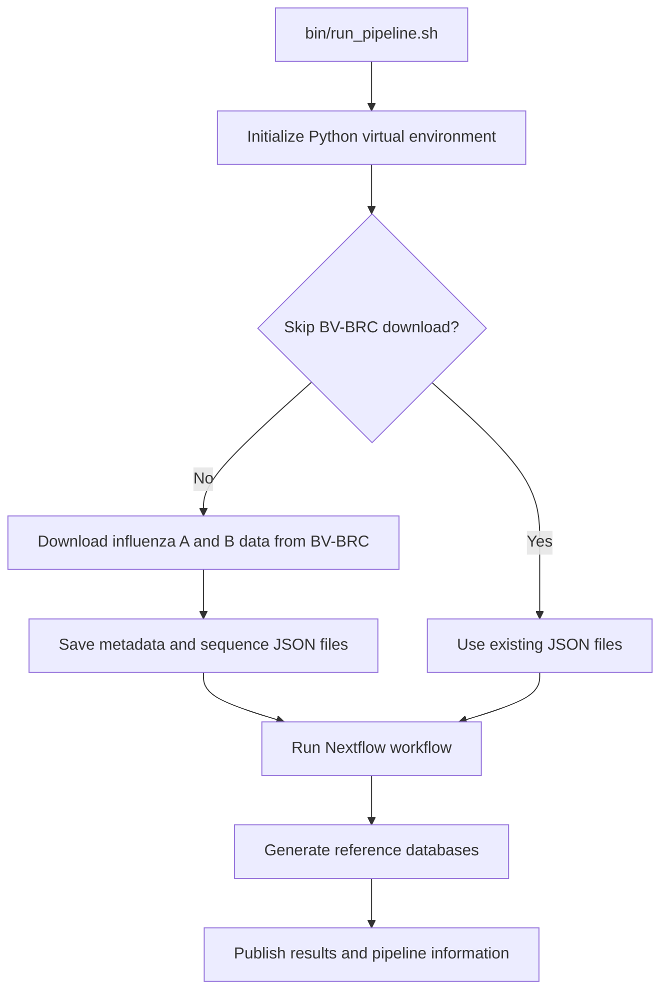
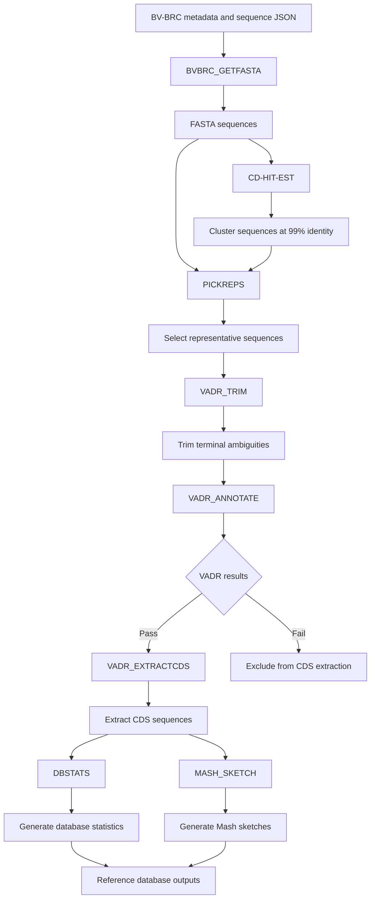

# fluab-reference-db

Automated reference database generation for the ProvLab influenza A and B bioinformatics pipeline, [`nf-fluab`](https://github.com/xiaoli-dong/nf-fluab).

`fluab-reference-db` retrieves influenza reference metadata and nucleotide sequences from [BV-BRC](https://www.bv-brc.org/), processes the downloaded data through a Nextflow workflow, and generates reference databases for downstream influenza sequence analysis.

The workflow is launched using `bin/run_pipeline.sh`, which automates Python environment setup, BV-BRC sequence and meta data retrieval, and Nextflow execution.

## Features

- Downloads influenza A and B reference metadata and nucleotide sequences from BV-BRC.
- Retrieves metadata and sequences in configurable batches.
- Supports configurable download limits for testing and development.
- Clusters similar sequences at 99% identity and selects representative sequences.
- Processes reference sequences using VADR for trimming, annotation, and validation.
- Extracts coding sequences (CDS) from validated references.
- Generates database statistics and Mash sketches.
- Generates reference database outputs for `nf-fluab`.
- Supports resuming interrupted Nextflow executions.
- Produces Nextflow execution reports and workflow information.

## Workflow overview

The workflow consists of two main stages: retrieving reference data and processing the downloaded data to generate the reference databases.

### 1. Data retrieval and pipeline execution

The launcher script prepares the Python environment, retrieves data from BV-BRC, and starts the Nextflow workflow.



### 2. Reference database generation

The Nextflow workflow processes the downloaded metadata and sequence data to generate the reference databases.



## Requirements
- Nextflow 25.10.4 or later, python3
- The pipeline includes configuration profiles for the supported execution environments. Select the profile appropriate for your system. The supported execution environments are listed below:
    - Docker, Singularity, Apptainer, Conda or Mamba, Podman, Shifter, or Charliecloud. In our organization, we are using singularity


## Installation

Clone the repository:

```bash
git clone https://github.com/xiaoli-dong/fluab-reference-db.git
cd fluab-reference-db
```

Ensure that the required software is available and that the `nf-core-4` Conda environment is configured before running the pipeline.

## Usage

### Run the pipeline

The recommended entry point is the launcher script:

```bash
bash bin/run_pipeline.sh
```

Specify an output directory:

```bash
bash bin/run_pipeline.sh --outdir results
```

By default, the launcher:

1. Creates or reuses the Python virtual environment (`.venv`).
2. Installs the required Python dependencies if needed.
3. Downloads influenza A and B metadata and sequences from BV-BRC.
4. Saves the downloaded JSON files under `data/` in the output directory.
5. Activates the `nf-core-4` Conda environment.
6. Runs the Nextflow workflow using the Singularity profile.
7. Uses the current date (`YYYYMMDD`) as the database version.
8. Runs Nextflow with `-resume`.

### Launcher options

| Option | Default | Description |
|---|---|---|
| `-h`, `--help` | — | Display launcher usage information. |
| `--outdir` | Current directory, or `OUTDIR_ENV` if set | Output directory for downloaded data and workflow results. |
| `--batch` | `200` | Metadata page size and sequence batch size. |
| `--seq-limit` | `200` | Maximum number of sequences returned per BV-BRC request. |
| `--max` | No limit | Maximum number of records retrieved per taxon. |

All numeric parameters must be positive integers.

For example, to limit downloads to 500 records per taxon:

```bash
bash bin/run_pipeline.sh --outdir test_results --max 500
```

To change the download batch size and sequence limit:

```bash
bash bin/run_pipeline.sh \
    --outdir results \
    --batch 100 \
    --seq-limit 100
```

### Override the database version

By default, the launcher uses the current date in `YYYYMMDD` format as the database version.

To specify a custom version:

```bash
DB_VERSION=2026.11 bash bin/run_pipeline.sh --outdir results
```

### Skip downloading reference data

If the BV-BRC data have already been downloaded, the download step can be skipped by setting `SKIP_DOWNLOAD=1`:

```bash
SKIP_DOWNLOAD=1 bash bin/run_pipeline.sh --outdir results
```

The following files must already exist in the selected output directory:

```text
results/
└── data/
    ├── meta_raw.json
    └── sequences_raw.json
```

The launcher still ensures that the Python virtual environment exists before running Nextflow.

### Pass additional Nextflow options

Arguments not recognized by the launcher are forwarded to `nextflow run`.

For example, to specify a custom Nextflow configuration file:

```bash
bash bin/run_pipeline.sh \
    --outdir results \
    -c conf/slurm.config
```

Other Nextflow options include:

| Option | Description |
|---|---|
| `-resume` | Resume a previous execution by reusing cached results where possible. |
| `-c` | Specify a custom Nextflow configuration file. |
| `-w` | Specify a custom Nextflow work directory. |
| `-profile` | Select Nextflow execution profiles. |

The launcher already specifies `-profile singularity` and `-resume`. Take this into account when supplying additional options.

### Run Nextflow directly

The Nextflow workflow can also be executed without the launcher when the BV-BRC JSON input files are already available.

```bash
nextflow run main.nf \
    -profile singularity \
    --seq_json_file results/data/sequences_raw.json \
    --meta_json_file results/data/meta_raw.json \
    --db_version 20261125 \
    --outdir results
```

Direct execution requires the metadata JSON file, sequence JSON file, database version, and output directory to be supplied.

The `--vadr_models_dir` parameter can be used to specify a different VADR influenza model directory. The configured default is:

```text
/nfs/APL_Genomics/db/prod/vadr/vadr-models-flu-1.6.3-2
```

### Display pipeline help

To display the available launcher options:

```bash
bash bin/run_pipeline.sh --help
```

To display the Nextflow pipeline parameters:

```bash
nextflow run main.nf --help
```

For more detailed parameter information:

```bash
nextflow run main.nf --help_full
```

## Output directory

The output directory contains the downloaded BV-BRC data, generated reference database files, and Nextflow execution information.

The general directory structure is:

```text
results/
├── data/
│   ├── meta_raw.json
│   └── sequences_raw.json
├── pipeline_info/
│   ├── execution_report_*.html
│   ├── execution_timeline_*.html
│   ├── execution_trace_*.txt
│   └── pipeline_dag_*.html
└── ...
```

The processed reference database files are generated and published by the Nextflow workflow. Their exact names and locations are determined by the workflow configuration.

## Reference database usage

The generated reference databases are intended for use with [`nf-fluab`](https://github.com/xiaoli-dong/nf-fluab), the ProvLab influenza A and B sequencing analysis pipeline.

The reference database is maintained separately from `nf-fluab`, allowing database updates to be performed independently of pipeline releases.

Refer to the [`nf-fluab` documentation](https://github.com/xiaoli-dong/nf-fluab) for instructions on configuring and using the generated reference database.

## License

This project is licensed under the MIT License. See [LICENSE](LICENSE) for details.
