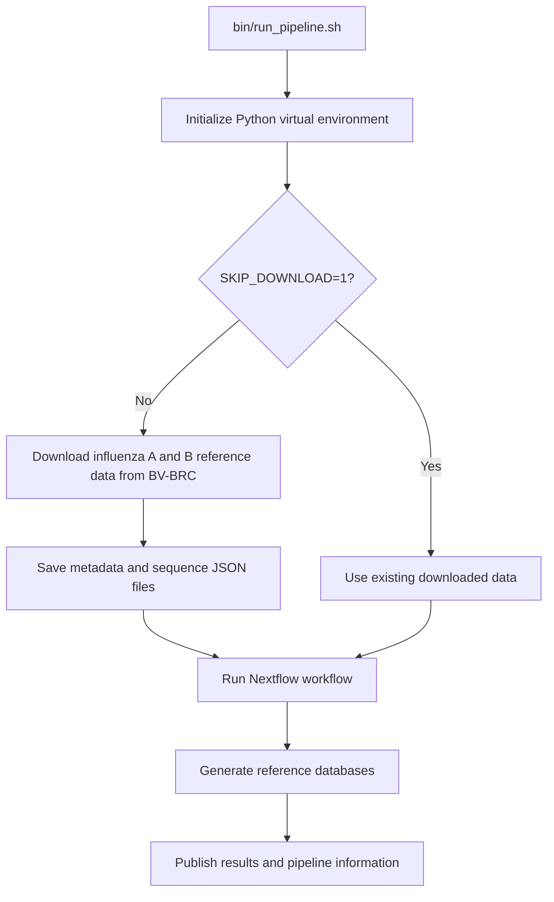
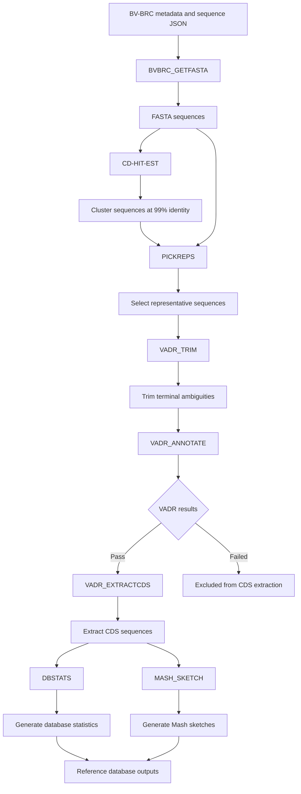

# fluab-reference-db

Automated reference database generation for the ProvLab influenza A and B bioinformatics pipeline, [nf-fluab](https://github.com/xiaoli-dong/nf-fluab).

`fluab-reference-db` downloads influenza reference sequence metadata and sequences from [BV-BRC](https://www.bv-brc.org/), processes the downloaded data through a Nextflow workflow, and generates reference databases for downstream influenza sequence analysis.

The workflow is designed to run through a single entry-point script, which handles Python environment setup, data downloading, and Nextflow execution.

## Features

- Automatically downloads influenza A and B reference data from BV-BRC.
- Retrieves sequence metadata and nucleotide sequences in batches.
- Supports configurable batch sizes and download limits.
- Processes downloaded data using a Nextflow workflow.
- Validates and processes influenza reference sequences using VADR.
- Generates versioned reference databases for `nf-fluab`.
- Supports resuming interrupted Nextflow runs.
- Produces Nextflow execution reports and workflow information.

## Workflow overview

The pipeline is launched through `bin/run_pipeline.sh`, which handles
environment setup, reference data downloading, and Nextflow execution.




### 2. Reference database processing workflow

Add this after the overall workflow:


### Reference database generation

The Nextflow workflow processes the downloaded BV-BRC reference sequences
through the following steps:



## Requirements

The following software and environment are required:

- Linux
- Python 3
- Conda
- Nextflow (version 25.10.4 or later)
- Singularity or Apptainer
- A Conda environment named `nf-core-4`, with nf-core tools installed

The entry-point script automatically creates a local Python virtual environment (`.venv`) and installs the Python dependencies from `requirements.txt` when needed.

## Installation

Clone the repository:

```bash
git clone https://github.com/xiaoli-dong/fluab-reference-db.git

cd fluab-reference-db
```

## Usage

### Run the pipeline

The main entry point is:

```bash
bash bin/run_pipeline.sh
```

By default, the script:

1. Creates the output directory in the current working directory.
2. Creates a Python virtual environment (`.venv`) if one does not already exist.
3. Installs the required Python dependencies.
4. Downloads influenza A and B metadata and sequences from BV-BRC.
5. Saves the downloaded JSON files under `data/`.
6. Activates the `nf-core-4` Conda environment.
7. Runs the Nextflow workflow using the Singularity profile.
8. Generates the reference database using the current date as the database version.

### Specify an output directory

```bash
bash bin/run_pipeline.sh --outdir results
```

### Configure download parameters

```bash
bash bin/run_pipeline.sh \
    --outdir results \
    --batch 200 \
    --seq-limit 200
```

| Parameter | Default | Description |
|---|---:|---|
| `--outdir` | Current directory | Output directory |
| `--batch` | 200 | Metadata page size and sequence batch size |
| `--seq-limit` | 200 | Maximum number of sequences per server request |
| `--max` | Unlimited | Maximum number of records per taxon |

For example, to limit downloads to 500 records per taxon:

```bash
bash bin/run_pipeline.sh --outdir results --max 500
```

### Override the database version

By default, the database version is generated using the current date (`YYYYMMDD`).

To specify a custom version:

```bash
DB_VERSION=20261125 bash bin/run_pipeline.sh --outdir results
```

### Resume a previous run

Nextflow supports resuming previously completed processes using `-resume`.

```bash
bash bin/run_pipeline.sh --outdir results -resume
```

### Skip downloading reference data

If the reference data have already been downloaded and are available in the output directory, the download step can be skipped.

```bash
SKIP_DOWNLOAD=1 bash bin/run_pipeline.sh --outdir results -resume
```

The expected input files are:

```text
results/
└── data/
    ├── meta_raw.json
    └── sequences_raw.json
```

### Use a different Nextflow profile

Additional Nextflow arguments are forwarded directly to `nextflow run`.

For example:

```bash
bash bin/run_pipeline.sh \
    --outdir results \
    -profile singularity,slurm
```

Other supported Nextflow options include:

- `-resume`: Resume a previous execution.
- `-c`: Specify a custom Nextflow configuration file.
- `-w`: Specify a custom Nextflow work directory.
- `-profile`: Select execution profiles.

### Display help

```bash
bash bin/run_pipeline.sh --help
```

## Output directory

The output directory contains the downloaded reference data, processed database files, and Nextflow execution information.

The general directory structure is:

```text
results/
├── data/
│   ├── meta_raw.json
│   └── sequences_raw.json
├── pipeline_info/
│   ├── execution_report_*.html
│   ├── execution_timeline_*.html
│   ├── execution_trace_*.txt
│   └── pipeline_dag_*.html
└── ...
```

The processed reference database outputs are generated by the Nextflow workflow.

## Repository structure

```text
fluab-reference-db/
├── bin/
│   ├── run_pipeline.sh
│   └── bvbrc_downloader.py
├── conf/
├── docs/
├── subworkflows/
├── workflows/
├── tests/
├── main.nf
├── nextflow.config
├── nextflow_schema.json
├── requirements.txt
└── README.md
```

## Related project

This repository generates reference databases for:

- [nf-fluab](https://github.com/xiaoli-dong/nf-fluab) – ProvLab influenza A and B sequence analysis pipeline.

## Author

Xiaoli Dong  
ProvLab – Public Health Laboratory Bioinformatics

## License

This project is licensed under the MIT License. See [LICENSE](LICENSE) for details.

## Acknowledgements

This pipeline uses the [nf-core](https://nf-co.re/) framework and community-maintained Nextflow modules.

Reference data are retrieved from [BV-BRC](https://www.bv-brc.org/).
